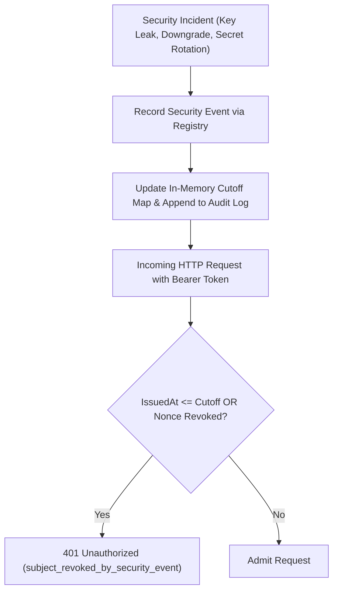

# Stale Session and Token Revocation After Security Events (#1031)

Stateless challenge tokens and HMAC bearer sessions protect self-service endpoints (`/api/wallet-session`) and privileged admin tasks (`/api/admin`). However, when security incidents occur—such as compromised wallet private keys, operator token leaks, permission downgrades, or root signing secret rotations—simply waiting for sessions to expire naturally leaves an unacceptable vulnerability window.

The Session Revocation Service (`server/src/services/sessionRevocationService.ts`) provides instantaneous, granular invalidation of stale sessions across both wallet sessions and operator admin tokens.

---

## 1. Revocation Mechanisms

1. **Subject Cutoff (`revokedBefore`)**:
   Sets a millisecond cutoff timestamp for an entity (a Stellar wallet address `G...` or an operator identifier `ops-...`).
   Any session presenting `issuedAt <= revokedBefore` is immediately refused (`401 Unauthorized`).
   New sessions created *after* the security event (with fresh wallet signatures or newly minted credentials) proceed normally.
2. **Specific Token / Nonce Revocation**:
   Revokes an individual token by its unique nonce without invalidating other valid sessions belonging to that actor.
3. **Global Emergency Cutoff (`targetSubject: "*"` )**:
   A global breaker for critical infrastructure events (e.g., suspected server secret leak). All tokens issued prior to the emergency timestamp are severed across the entire marketplace.

---

## 2. Security Event Lifecycle



---

## 3. Integration Points

- **Wallet Sessions (`server/src/middleware/walletSession.ts`)**:
  - `requireWalletSession`: Verifies `globalSessionRevocationRegistry.isRevoked(wallet, payload.issuedAt, payload.nonce)`.
  - `hasFreshWalletSession`: Validates step-up authentication tokens against active revocation cutoffs.
- **Admin Tokens (`server/src/services/adminToken.ts`)**:
  - `verifyAdminToken`: Checks operator subjects against active cutoffs.

---

## 4. Performance & Bounded Storage

- **Time Complexity**: $O(1)$ constant time lookup in hash maps during request authentication.
- **Space Complexity**: $O(M)$ bounded memory. Revocation records are automatically pruned after `MAX_REVOCATION_RETENTION_MS` (2 hours). Because tokens have a maximum TTL (e.g. 30–60 minutes), any token issued before an expired cutoff has already expired naturally, preventing memory leaks.

---

## 5. Operational Recovery & Rollback

- **False Alarm Recovery (`reinstateSubject`)**:
  If a security alert is verified as a false positive, authorized operators (`admin` or `security:revoke`) can call `reinstateSubject(subject, actor, reason)`. The subject's cutoff is removed, immediately restoring valid access and recording an audit trail entry.
- **Audit Logging**:
  All security events and reinstatements are logged in the immutable security audit log (`getAuditTrail()`).

---

## 6. Security Event Policy and User Messaging (#908)

`SECURITY_EVENT_POLICY` in `sessionRevocationService.ts` says which events end
sessions, and how far:

| Event | Scope | When to use |
| --- | --- | --- |
| `credential_change` | Subject | Password or key changed |
| `role_change` | Subject | Role or permission level changed for the account |
| `account_recovery` | Subject | Recovery flow completed |
| `explicit_logout_all` | Subject | User asked to sign out everywhere |
| `wallet_compromise`, `suspicious_activity`, `permission_revocation`, `admin_key_rotation` | Subject | As named |
| `global_emergency_cutoff` | Global (`*`) | Platform-wide secret rotation only |

Call `invalidateSessionsForSecurityEvent(registry, input)` in the same request
that changes the credential, role or recovery state. It enforces the scope: a
subject event must name one account, and a global event must target `*`.

**User messages.** A rejected session gets `401` with `error` (a user-safe
message from the event policy) and `code`. The internal `reason` is never
returned to the client. Operators read it from the registry status and the
audit trail.

**Unaffected sessions.** Subject events only cut off that account. Other
accounts' sessions keep working, and sessions issued after the event sign in
normally.

---

## 7. Wallet Session Guard: Edge Cases, Recovery and Verification (#1133)

`requireWalletSession` (`server/src/middleware/walletSession.ts`) is the admission
point for `Authorization: Bearer` wallet sessions. It checks revocation after the
token signature, expiry, wallet binding and action. The table lists the outcome for
each path.

| Path | Result | Client-visible `code` |
| --- | --- | --- |
| Valid session for its own wallet | `next()`; `req.sessionWallet` set | none |
| Wallet param lower-case | Normalized to the account form, then admitted | none |
| Malformed wallet address | `400` before the token is read | none |
| Missing bearer token | `401` | none |
| Expired token, or token for another wallet | `401` | none |
| Unlock challenge replayed as a session | `401` (action mismatch) | none |
| Session secret not configured | `503`, no detail returned | none |
| Session issued before a subject security event | `401` with the policy's user-safe message | `subject_revoked_by_security_event` |
| Session issued after the event | `next()`; the user signs in again | none |
| Other accounts after one subject event | Unaffected | none |

**Edge cases**

- Wallet addresses are 56-character Stellar strkeys (`G` plus 55 base32 characters).
  The guard previously required 56 characters after the `G`, which rejected every
  real wallet. Revocation normalization uses the same 55-character form.
- The internal revocation `reason` never appears in a response. Check it in the
  audit trail and the registry status only.
- A cutoff more than 60 seconds in the future is refused (`invalid_timestamp`), so a
  mis-set clock cannot pre-revoke sessions that do not exist yet.
- Revocation records are retained for `MAX_REVOCATION_RETENTION_MS`. A token older
  than that has already expired, so pruning cannot readmit a revoked session.

**Recovery and rollback**

- For a false alarm, an authorized operator (`admin` or `security:revoke`) calls
  `reinstateSubject(subject, actor, reason)`. Pre-event sessions work again, and the
  reinstatement is audited. A viewer call throws `unauthorized` and changes nothing.
- A user whose session was revoked signs a new challenge. The new session is
  admitted because it was issued after the cutoff.

**Verification**

```bash
cd server
npx vitest run src/tests/walletSessionRevocation.test.ts \
  src/tests/sessionRevocationService.test.ts \
  src/tests/sessionInvalidationPolicy.test.ts \
  src/tests/abuseRiskGuard.test.ts
```

Step-up decisions use `hasFreshWalletSession`, so a session older than the step-up
window (5 minutes by default) does not count as a fresh signature, and a revoked
session does not either.
