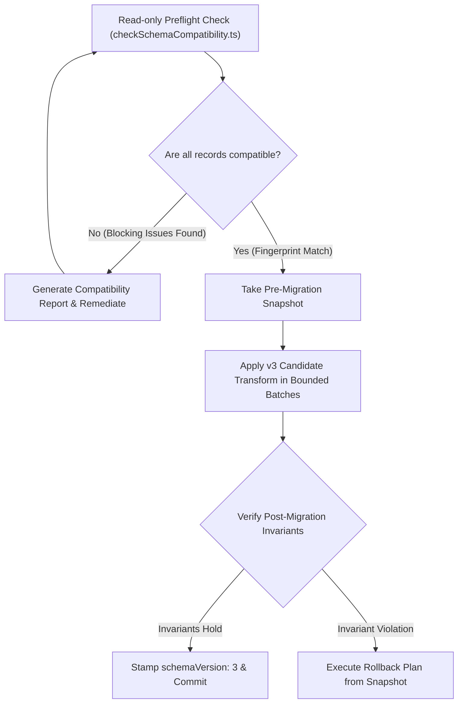

# Versioned Schema Migration Notes & Compatibility Contracts

## 1. Executive Summary

This document specifies the versioned schema transition framework for PromptHash Stellar document storage contracts across all supported versions (**v0**, **v1**, **v2**, and target **v3**).

The Soroban smart contract on Stellar acts as the authoritative source of truth for prompt ownership and licensing. The off-chain storage layer (MongoDB and cached projection store) must preserve semantic equivalence across migrations without data loss, price drift, or unauthorized entitlement corruption.

---

## 2. Version Evolution Matrix

| Schema Version | Release Stage | Key Attributes & Structural Invariants | Compatibility / Transition Status |
| :--- | :--- | :--- | :--- |
| **v0** (Alpha) | Initial Prototype | Unverified `price` (arbitrary units), `image` string, optional `description`, no formal `licence`. | Legacy. Requires normalisation and explicit price backfilling. |
| **v1** (Beta) | Pre-Stroop | Introduced `subcategory` field (deprecated in favor of `tags`), `isActive` boolean flag, raw token amounts. | Deprecated. `subcategory` folds into `tags`. |
| **v2** (Current Prod) | Soroban Launch | Authoritative `priceStroops` (1 XLM = 10,000,000 stroops), `imageUrl`, `active` boolean, `lifecycleState`, and `moderationStatus`. Backward-compatible aliases (`image`, `price`, `isActive`, `listingStatus`) retained. | Production baseline (`CURRENT_PROMPT_SCHEMA_VERSION = 2`). |
| **v3** (Target) | Hardened Storage | **Removes deprecated aliases entirely**. Enforces strict typing for `imageUrl`, `priceStroops`, `active`, and `lifecycleState`. Requires canonical fields. | Next version (`NEXT_PROMPT_SCHEMA_VERSION = 3`). |

---

## 3. Field Renaming & Alias Deprecation Rules

### 3.1 Safely Convertible Aliases
The following aliases are mapped 1-to-1 when the candidate target does not present a conflict:
1. `image` $\rightarrow$ `imageUrl`: String URI representation.
2. `isActive` $\rightarrow$ `active`: Boolean representation.
3. `listingStatus` $\rightarrow$ `lifecycleState`: Mapped to standard lifecycle state (`draft`, `published`, `archived`, etc.).

### 3.2 Blocked Conversion: `price` vs `priceStroops`
> [!CRITICAL]
> Legacy `price` predates the Soroban Stroop contract and holds no standardized currency unit.
> Converting legacy `price` by arbitrary multiplication could silently misprice assets and corrupt payments.
> Therefore:
> - Records with only `price` and no `priceStroops` trigger a blocking `unmapped_deprecated_field` error.
> - The operator must explicitly backfill `priceStroops` from on-chain Soroban contract state or authoritative catalog records.

### 3.3 Conflicting Renames
When both an alias and its replacement exist on a document (e.g. `image` and `imageUrl`), they **must** have identical values. Any discrepancy triggers a blocking `conflicting_rename` error to prevent silent data clobbering.

---

## 4. Operational Migration Workflow

### 4.1 Normal Path
1. Run preflight compatibility verification: `npm run schema:compat -- --input snapshot.json --json`.
2. Ensure report indicates `compatible: true` with zero blocking errors.
3. Record the deterministic `fingerprint` hash.
4. Execute migration in bounded chunks with checkpointing.

### 4.2 Failure & Invalidation Path
- Records written by newer versions (`schemaVersion > targetVersion`) trigger `future_schema_version` errors. Downgrades are rejected.
- Invalid field types or missing non-defaultable required fields (such as `title`) block migration.

### 4.3 Retry & Idempotency Path
- The migration candidate transformation is **pure and deterministic**.
- Re-running the check or migration on an already-migrated dataset produces identical candidate hashes (`fingerprint_1 === fingerprint_2`).

### 4.4 Rollback Procedure
If a migration fails mid-run:
1. Cease batch processing at current batch cursor.
2. Restore modified records from the pre-migration snapshot using record IDs.
3. Validate database integrity using `npm run validate:invariants`.

