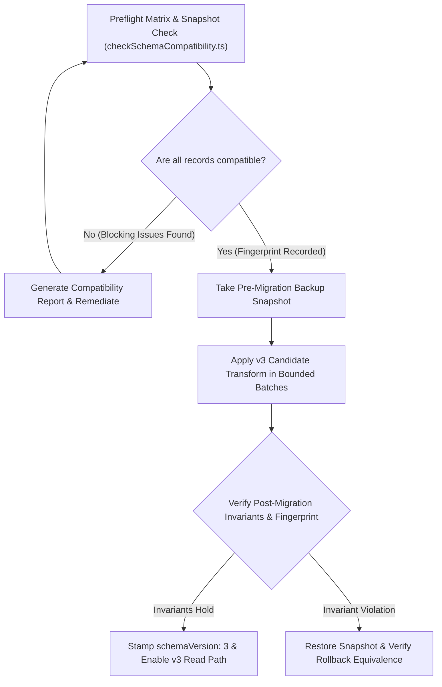

# Versioned Schema Migration Notes, Compatibility Matrix & Fixtures

## 1. Executive Summary

This document specifies the versioned schema transition framework, compatibility matrix, and checked-in fixture suite for PromptHash Stellar document storage contracts across all supported versions (**v0**, **v1**, **v2**, and target **v3**).

The Soroban smart contract on Stellar acts as the authoritative source of truth for prompt ownership and licensing. The off-chain storage layer (MongoDB and cached projection store) must preserve semantic equivalence across migrations without data loss, price drift, or unauthorized entitlement corruption.

---

## 2. Version Evolution & Compatibility Matrix

| Fixture Suite | Source Schema | Target Schema | Expected Disposition | Warnings / Blocking Errors | Rollback & Recovery Strategy |
| :--- | :--- | :--- | :--- | :--- | :--- |
| `v0_legacy` | **v0** (Alpha / Unversioned) | **v3** | `compatible_with_warnings` | `legacy_version_upgrade` (warning) | Restore pre-migration v0 snapshot and verify SHA-256 fingerprint equivalence; v2 read path preserves legacy defaults. |
| `v1_legacy` | **v1** (Pre-Stroop Beta) | **v3** | `compatible_with_warnings` | `legacy_version_upgrade` (warning); unknown `subcategory` retained for review | Restore pre-migration v1 snapshot at batch boundary and confirm rollback equivalence against retained source documents. |
| `v2_production` | **v2** (Current Prod) | **v3** | `compatible_with_warnings` | `conflicting_rename` warning when legacy `price` coexists with authoritative `priceStroops` | Revert batch writes from retained v2 backup; keep dual-read aliases active until post-migration verification completes. |
| `v3_target` | **v3** (Hardened Target) | **v3** | `compatible_with_warnings` | `legacy_version_upgrade` (no-op candidate warning); custom unknown fields preserved | No-op transition; records are already at v3. Use pre-upgrade backup only if rolling back the entire deployment to v2. |
| `incompatible_cases` | **Mixed** (`v1`, `v2`, `v99`) | **v3** | `blocked` | `unmapped_deprecated_field`, `conflicting_rename`, `future_schema_version`, `missing_required_field` | Fail-closed preflight gate blocks execution before any write occurs; remediate source records or upgrade consumer build. |

---

## 3. Field Renaming & Alias Deprecation Rules

### 3.1 Safely Convertible Aliases
The following aliases are mapped 1-to-1 when the candidate target does not present a conflict:
1. `image` $\rightarrow$ `imageUrl`: String URI representation.
2. `isActive` $\rightarrow$ `active`: Boolean representation.
3. `listingStatus` $\rightarrow$ `lifecycleState`: Mapped to standard lifecycle state (`draft`, `review`, `published`, `hidden`, `archived`) with moderation status taking precedence (`retired` $\rightarrow$ `archived`, `restricted` $\rightarrow$ `hidden`, `isActive: false` $\rightarrow$ `hidden`).

### 3.2 Blocked Conversion: `price` vs `priceStroops`
> [!CAUTION]
> Legacy `price` predates the Soroban Stroop contract and holds no standardized currency unit.
> Converting legacy `price` by arbitrary multiplication could silently misprice assets and corrupt payments.
> Therefore:
> - Records with only `price` and no `priceStroops` trigger a blocking `unmapped_deprecated_field` error.
> - The operator must explicitly backfill `priceStroops` from on-chain Soroban contract state or authoritative catalog records.

### 3.3 Conflicting Renames
When both an alias and its replacement exist on a document (e.g. `image` and `imageUrl`, `active` and `isActive`, or `listingStatus` and `lifecycleState`), they **must** have equivalent values. Any discrepancy triggers a blocking `conflicting_rename` error to prevent silent data clobbering.

---

## 4. Admin API & CLI Verification

### 4.1 CLI Gate
```bash
# Evaluate the full checked-in schema migration compatibility matrix and fixtures:
cd server
npm run schema:compat -- --matrix
npm run schema:compat -- --matrix --json

# Evaluate a specific snapshot file:
npm run schema:compat -- --input fixtures/migrations/v2_production.json --json
```

### 4.2 Admin HTTP Endpoints
All endpoints under `/api/admin/schema-migrations` require a valid HMAC-signed admin bearer token (`requireAdminScope`) and enforce role/scope authorization:

| Method & Path | Required Scope | Purpose |
| :--- | :--- | :--- |
| `GET /api/admin/schema-migrations/matrix` | `schema:read` | Evaluates the compatibility matrix across all checked-in fixtures (or filtered via `?fixtures=v0_legacy,v2_production&toVersion=3`). |
| `GET /api/admin/schema-migrations/fixtures` | `schema:read` | Returns the fixture catalog metadata and record counts, or a single fixture payload via `?name=v1_legacy`. |
| `POST /api/admin/schema-migrations/evaluate` | `schema:write` | Runs read-only compatibility evaluation against a named `fixture` or an ad-hoc `records` array. |
| `POST /api/admin/schema-migrations/verify-rollback` | `schema:write` | Verifies canonical rollback equivalence and SHA-256 fingerprint parity between `originalRecords` and `restoredRecords`. |

---

## 5. Operational Migration Workflow



### 5.1 Normal Path
1. Run preflight matrix verification: `npm run schema:compat -- --matrix --json`.
2. Run snapshot preflight check: `npm run schema:compat -- --input snapshot.json --json`.
3. Ensure report indicates `compatible: true` with zero blocking errors and record the deterministic `fingerprint`.
4. Execute migration in bounded chunks with checkpointing.

### 5.2 Failure & Edge Cases
- **Future Schema Version (`future_schema_version`)**: Records written by newer versions (`schemaVersion > targetVersion`) fail closed. Downgrades are never attempted; roll the deployment forward instead.
- **Conflicting Aliases (`conflicting_rename`)**: Disagreements between `image`/`imageUrl`, `active`/`isActive`, or `listingStatus`/`lifecycleState` block migration until reconciled.
- **Missing Required Fields (`missing_required_field`)**: Non-defaultable required fields (such as `title`) block migration.
- **Custom Unknown Fields**: Unrecognized fields (e.g. `subcategory`, `customProvenanceTag`) are preserved unchanged in the candidate and listed in `unknownFields` for operator audit.

### 5.3 Retry & Idempotency Path
- Both `verifyMigrationFixtureSet` and `buildSchemaMigrationCompatibilityMatrix` are **pure and deterministic**.
- Re-running the check on the same snapshot or already-migrated `v3_target` records produces identical candidate hashes (`fingerprint_1 === fingerprint_2` and `matrixFingerprint_1 === matrixFingerprint_2`).

### 5.4 Rollback Procedure
If a migration fails mid-run or post-check invariants fail:
1. Stop batch processing at the current batch boundary.
2. Restore modified records from the pre-migration snapshot using record IDs.
3. Verify canonical restoration using `verifyRollbackEquivalence` (or `POST /api/admin/schema-migrations/verify-rollback`) and confirm the restored snapshot's fingerprint matches the pre-migration fingerprint.
4. Keep dual-read support for `image`, `price`, `isActive`, and `listingStatus` active in v2 until rollback recovery is complete.
